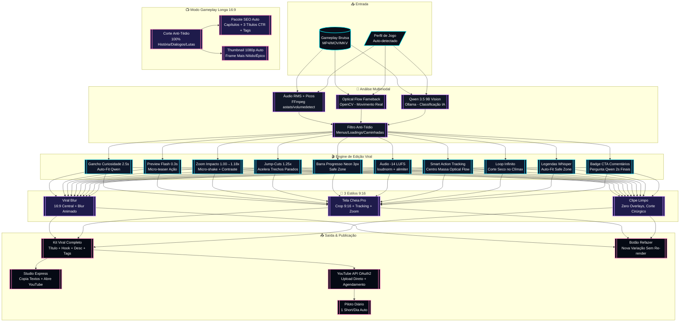

<p align="center">
  
</p>

<p align="center">
  <a href="https://github.com/lcszero44-cell/ClipRush-Studio-Pro/releases"></a>
  <a href="https://github.com/lcszero44-cell/ClipRush-Studio-Pro/blob/main/LICENSE"></a>
  <a href="https://github.com/lcszero44-cell/ClipRush-Studio-Pro/stargazers"></a>
  <a href="https://github.com/lcszero44-cell/ClipRush-Studio-Pro/issues"></a>
  <br/>
  <a href="https://www.python.org/downloads/"></a>
  <a href="https://fastapi.tiangolo.com/"></a>
  <a href="https://ollama.com/"></a>
  <a href="https://opencv.org/"></a>
  <a href="https://ffmpeg.org/"></a>
  <a href="https://github.com/lcszero44-cell/ClipRush-Studio-Pro"></a>
  <a href="https://github.com/lcszero44-cell/ClipRush-Studio-Pro"></a>
</p>

---

## 🎯 Visão Geral

**ClipRush Studio Pro** é um **estúdio local de edição viral com IA** para criadores de conteúdo de games. Transforma gameplays brutas de PS4, PS5 e PC em **cortes virais 9:16** (TikTok, YouTube Shorts, Reels) e **gameplays longas editadas 16:9** (YouTube 1080p) — **sem precisar de microfone**.

> **Diferencial:** Motor multimodal híbrido (Áudio RMS + OpenCV Optical Flow + Visão Computacional Qwen 3.5 9B via Ollama) roda **100% local, offline**, sem taxas de API e sem upload de vídeos para nuvem.

| Modo | Formato | Uso Ideal | Saída |
|------|---------|-----------|-------|
| **Cortes Virais** | 9:16 (1080×1920) | TikTok, YouTube Shorts, Instagram Reels | MP4 + Kit Viral (Título, Hook, Descrição, Hashtags, Thumb) |
| **Gameplay Longa** | 16:9 (1920×1080) | YouTube Episódios, Highlights, Compilações | MP4 + Capítulos, 3 Títulos CTR, Descrição SEO, Tags, Thumbnail 1080p |

### Por que ClipRush Studio Pro?

- 🔒 **Privacidade Total** — Seus vídeos nunca saem do seu PC. Zero upload para nuvem.
- 💰 **Zero Custo Recorrente** — Sem assinaturas, sem créditos de API, sem limites de uso.
- 🎮 **Perfis Calibrados PS4/PS5** — Sniper Elite, Spider-Man, RDR2, Resident Evil, God of War + Genérico.
- ⚡ **10 Mecânicas de Retenção Viral** integradas no render (ver abaixo).
- 🤖 **Piloto Automático Diário** — Publica 1 Short por dia no YouTube via OAuth2 oficial (opcional).
- 🖥️ **Interface Web Moderna** — Acesse em `http://127.0.0.1:8765` no navegador.

---

## 🏗️ Arquitetura do Sistema



---

## ⚡ Principais Recursos

<details open>
<summary><strong>🧠 Motor Multimodal de Análise</strong></summary>

| Componente | Tecnologia | Função |
|------------|------------|--------|
| **Áudio RMS + Picos** | FFmpeg `astats`/`volumedetect` | Detecta explosões, tiros, gritos, sustos |
| **Optical Flow Farneback** | OpenCV 4.10+ | Mede movimento real, ignora menus/loadings parados |
| **Qwen 3.5 9B Vision** | Ollama Local | Classifica frames: headshots, execuções R3, Game Over, jump scares, mortes cinematográficas |
| **Filtro Anti-Tédio** | Heurísticas customizadas | Remove automaticamente menus do PS4, telas de loading, caminhadas vazias longas |

</details>

<details open>
<summary><strong>🎬 10 Mecânicas de Retenção Viral (Modo 9:16)</strong></summary>

| # | Mecânica | Descrição Técnica |
|---|----------|-------------------|
| 1 | **Gancho de Curiosidade (2,5s)** | Texto ≤6 palavras no topo, Auto-Fit MarginV=140, gerado pelo Qwen 3.5 |
| 2 | **Preview Flash (0,3s)** | Micro-teaser do pico da ação no frame 0 para prender atenção imediata |
| 3 | **Zoom de Impacto Inteligente** | Punch-In/Out `1.00x → 1.18x → 1.00x` (0,6s) + micro-shake + contraste sincronizado **apenas nos picos reais** |
| 4 | **Jump-Cuts Inteligentes (1.25x)** | Acelera trechos internos sem ação (>2,5s) mantendo ritmo frenético |
| 5 | **Barra de Progresso Neon (3px)** | Barra roxo/ciano na Safe Zone guiando o espectador até o clímax |
| 6 | **Áudio -14 LUFS + Limiter/Ducking** | `loudnorm` + `alimiter` no FFmpeg para volume alto, nítido e padronizado para celular |
| 7 | **Smart Action Tracking** | Estilo **Tela Cheia Pro**: rastreia centro de massa do Optical Flow a cada 1s e move o crop 9:16 suavemente |
| 8 | **Loop Infinito** | Corte seco no clímax (morte/pico) sem segundos mortos → maximiza replays automáticos |
| 9 | **Legendas Whisper Auto-Fit** | `faster-whisper` com Safe Zone (MarginL/R=60, MarginV=260) + zoom cinematográfico suave 1.06x nos diálogos |
| 10 | **Badge CTA Comentários** | Pergunta gerada pelo Qwen nos 2s finais (ex: *"Você escaparia dessa?"*) para estimular engajamento |

</details>

<details>
<summary><strong>🎮 3 Estilos de Enquadramento 9:16 (1 Clique)</strong></summary>

| Estilo | Descrição | Ideal Para |
|--------|-----------|------------|
| **Viral Blur** | 16:9 centralizada sem cortar HUD/legendas + fundo blur animado | Jogos com HUD importante, legendas PT-BR na tela |
| **Tela Cheia Pro** | Crop 9:16 preenchido com foco inteligente + Zoom de Impacto + Action Tracking | Ação pura, máximo impacto visual |
| **Clipe Limpo** | Zero textos sobrepostos — apenas corte cirúrgico, zoom e correção de cor | Reels/Shorts "raw", edição posterior manual |

</details>

<details>
<summary><strong>📺 Modo Gameplay Longa (16:9 1080p)</strong></summary>

- **Corte Anti-Tédio Limpo** — Remove loadings, menus PS4, pausas, caminhadas vazias; mantém 100% história/diálogos/lutas.
- **Pacote SEO Automático** — Capítulos com timestamps, **3 Títulos CTR**, Descrição SEO completa, Tags otimizadas (via Qwen 3.5).
- **Thumbnail 1080p** — Frame mais nítido/épico exportado automaticamente pronto para capa do YouTube.

</details>

<details>
<summary><strong>📦 Kit Viral Automático + Botão "Refazer"</strong></summary>

- Título viral, Hook 2s, Descrição com gancho de comentário, Hashtags otimizadas.
- **Botão "Refazer"** gera nova variação criativa via Qwen 3.5 Vision **sem re-renderizar o MP4**.

</details>

<details>
<summary><strong>🚀 Publicação 1-Clique & Piloto Automático Diário</strong></summary>

| Modo | Descrição |
|------|-----------|
| **Studio Express** | Copia textos, abre `studio.youtube.com` + pasta do MP4 (sem API) |
| **API Oficial YouTube (OAuth2)** | Conecta conta via `client_secrets.json` do Google Cloud |
| **Piloto Automático Diário** | Publica 1 Short inédito/dia no horário fixo com Título, Descrição e `#Shorts` otimizados |

</details>

---

## 🏗️ Estrutura do Projeto

```
ClipRush_Pro_V2/
├── backend/
│   ├── __init__.py
│   ├── app.py             # FastAPI Server (porta 8765)
│   ├── config.py          # Paths, FFmpeg/Ollama discovery, Game Profiles
│   ├── analyzer.py        # Análise multimodal (Audio + Optical Flow + Qwen Vision)
│   ├── editor.py          # Render viral (9:16) e longa (16:9) com FFmpeg
│   ├── ollama_client.py   # Cliente Qwen 3.5 9B Vision + geração de kits
│   ├── youtube_uploader.py# OAuth2 + Upload + Piloto Automático Diário
│   ├── storage.py         # JSON storage (projetos, clipes, agendamentos)
│   └── errors.py          # Painel Raio-X de Erros (diagnóstico estruturado)
├── frontend/
│   ├── index.html         # SPA completa (5 views, stepper 3 etapas)
│   ├── css/styles.css     # Design system dark, glassmorphism, neon accents
│   └── js/
│       ├── app.js         # Lógica principal (state, routing, API calls)
│       ├── api.js         # Cliente API tipado
│       ├── tooltips.js    # Sistema de tooltips acessíveis
│       └── xray.js        # Modal Painel Raio-X de Erros
├── data/
│   ├── client_secrets.example.json  # Exemplo para OAuth2 YouTube
│   ├── settings.json       # Configurações do usuário
│   ├── projects.json       # Projetos importados/analisados
│   ├── clips_library.json  # Clipes renderizados (biblioteca)
│   └── youtube_autopilot.json # Fila do piloto diário
├── saida/                  # 📁 Output: MP4s finais + Thumbnails (gitignored)
├── data/uploads/           # 📁 Uploads temporários (gitignored)
├── data/temp/              # 📁 Cache de análise/frames (gitignored)
├── data/thumbs/            # 📁 Miniaturas de momentos (gitignored)
├── assets/                 # 📁 Ícones, logo, banner.svg
├── scripts/
│   ├── generate_assets.py  # Gera ícone PNG/ICO + atalho Desktop
│   └── validate_app.py     # Validação rápida de saúde do app
├── tray_launcher.py        # System Tray (inicia servidor + abre navegador)
├── iniciar.bat             # Launcher Windows (PATH FFmpeg, libera porta 8765)
├── iniciar.vbs             # Launcher silencioso (sem console) para atalho
├── requirements.txt        # Dependências Python
└── .gitignore              # Proteção de dados sensíveis e arquivos pesados
```

---

## 📦 Instalação Rápida (Windows)

<details>
<summary><strong>🔧 1. Pré-requisitos</strong></summary>

| Item | Versão Mínima | Verificação | Download |
|------|---------------|-------------|----------|
| **Python** | 3.12+ | `python --version` | [python.org](https://www.python.org/downloads/) |
| **FFmpeg** | 9.0+ no PATH ou `D:\ClipRush_Universal\ffmpeg-9.0.2-full_build\bin` | `ffmpeg -version` | [gyan.dev/ffmpeg/builds](https://www.gyan.dev/ffmpeg/builds/) |
| **Ollama** | Instalado + modelo `qwen3.5:9b` | `ollama list` | [ollama.com](https://ollama.com/download) |

> **Dica FFmpeg:** O app detecta automaticamente em `D:\ClipRush_Universal\ffmpeg-9.0.2-full_build\bin`. Se instalar em outro local, adicione ao PATH do Windows ou configure em **Configurações → Caminho do FFmpeg**.

**Instalar modelo Qwen 3.5 9B:**
```powershell
ollama pull qwen3.5:9b
```
</details>

<details>
<summary><strong>📥 2. Clonar & Preparar Ambiente</strong></summary>

```powershell
# 1. Clone o repositório
git clone https://github.com/lcszero44-cell/ClipRush-Studio-Pro.git
cd ClipRush-Studio-Pro

# 2. Crie e ative ambiente virtual
python -m venv .venv
.venv\Scripts\activate

# 3. Instale dependências
python -m pip install --upgrade pip
pip install -r requirements.txt

# 4. (Opcional) Playwright para validações
playwright install chromium
```
</details>

<details>
<summary><strong>🎨 3. Gerar Ícone & Atalho Desktop</strong></summary>

```powershell
python scripts/generate_assets.py
```
Cria: `assets/cliprush.png` (512×512), `assets/cliprush.ico` (multi-res), atalho **"ClipRush Studio Pro"** na Área de Trabalho.
</details>

<details>
<summary><strong>▶️ 4. Executar</strong></summary>

**Opção A — Atalho (Recomendado):**  
Duplo clique no atalho **"ClipRush Studio Pro"** na Área de Trabalho.

**Opção B — Terminal:**
```powershell
# Com .venv ativado
python tray_launcher.py
```
Ou use o launcher batch:
```cmd
iniciar.bat
```

**Acesse a interface em:** `http://127.0.0.1:8765`
</details>

---

## ⚙️ Configuração Opcional: YouTube API OAuth2

<details>
<summary><strong>Para Piloto Automático Diário & Upload Direto</strong></summary>

### Passo 1: Google Cloud Console
1. Acesse: <https://console.cloud.google.com/apis/credentials>
2. Crie/selecione projeto (ex: `ClipRush Studio`)
3. **Ative a YouTube Data API v3**: APIs e Serviços → Biblioteca → "YouTube Data API v3" → **Ativar**
4. **Crie ID do Cliente OAuth**:
   - Credenciais → Criar Credenciais → ID do cliente OAuth
   - Tipo: **App para computador (Desktop app)**
   - Nome: `ClipRush Studio Pro`
   - **Baixe o JSON** → `client_secrets.json`

### Passo 2: Importar no ClipRush
1. Abra `http://127.0.0.1:8765` → **Configurações** → **Conexão Oficial YouTube**
2. Clique em **"Carregar client_secrets.json"** e selecione o arquivo
3. Clique em **"Conectar Conta YouTube"** → autorize no navegador
4. Badge fica **Verde "Conectado"** com nome do canal

### Passo 3: Ativar Piloto Diário
1. Vá em **Agendador & Publicação** → **Piloto Automático Diário YouTube Shorts**
2. Configure: Horário (ex: `18:30`), Visibilidade (`Público` recomendado), Ative **"Piloto Diário Ativo"**
3. Clique **"Salvar Piloto Diário"**
4. Adicione clipes à fila: **"Importar Biblioteca em Lote"** ou selecione um a um
</details>

---

## 🎮 Perfis de Jogo Calibrados (PS4/PS5)

| Perfil | Jogos Cobertos | Foco Principal |
|--------|----------------|----------------|
| **Sniper Elite** | Sniper Elite, Ghost Recon, Hitman, Metal Gear | Headshots longa distância, câmera Raio-X, explosões |
| **Spider-Man** | Spider-Man, Miles Morales, Batman Arkham, inFamous | Balanços alta velocidade, combos aéreos, finalizações |
| **Red Dead 2** | RDR2, GTA V, Cyberpunk 2077, Western | Duels, Dead Eye, tiroteios, eventos aleatórios |
| **Resident Evil** | RE2/3/4/7/8 Remake, Village, Last of Us, Outlast | Jump scares, chefes, serra elétrica, Game Over |
| **God of War** | GoW Ragnarök, Devil May Cry, Elden Ring, Ghost of Tsushima | Execuções R3, Fúria Espartana, Valkyrias/Chefes |
| **Genérico** | Qualquer jogo PS4/PS5/PC | Hibrido universal balanceado |

> Detecção **automática pelo nome do arquivo** (ex: `GodOfWar_Ragnarok_PS5.mp4` → perfil `god_of_war`).

---

## 🛠️ Scripts Úteis

```powershell
# Validar saúde do app (FFmpeg, Ollama, portas, pastas)
python scripts/validate_app.py

# Regenerar ícone e atalho Desktop
python scripts/generate_assets.py

# Limpar cache Python e reinstalar
Remove-Item -Recurse -Force .venv
python -m venv .venv
.venv\Scripts\activate
pip install -r requirements.txt
```

---

## 🔧 Configurações Avançadas (Configurações →)

| Configuração | Padrão | Descrição |
|--------------|--------|-----------|
| **URL Ollama** | `http://localhost:11434` | Endpoint da API local do Ollama |
| **Modelo Qwen** | `qwen3.5:9b` | Nome exato do modelo instalado (`ollama list`) |
| **FFmpeg Path** | Auto-detect | Caminho customizado do `ffmpeg.exe` |
| **Pasta de Saída** | `D:\ClipRush_Pro_V2\saida` | Onde salvam MP4s finais e thumbs |
| **Encoder** | `auto` | `auto` (NVENC se GPU NVIDIA / libx264), `h264_nvenc`, `libx264` |
| **Whisper Model** | `base` | `tiny`/`base`/`small` para legendas de cutscenes |
| **Duração Mín/Max** | 12s / 45s | Limites dos clipes virais 9:16 |
| **Sensibilidade** | 0.55 | Threshold de detecção de momentos (0.1–1.0) |
| **Visão Qwen 3.5** | Ativado | Envia frames para classificação viral precisa |

---

## 🐛 Painel Raio-X de Erros

Todo erro crítico (FFmpeg, Ollama, Upload, Render) abre um **modal estruturado** com:

1. **Explicação Simples** — O que aconteceu em português claro.
2. **Arquivo e Linha Exata** — Caminho + número da linha do erro.
3. **Detalhe Técnico** — Traceback completo.
4. **Botão "Copiar Erro para IA"** — Copia diagnóstico formatado para colar no ChatGPT/Claude/Gemini e resolver instantaneamente.

> Teste: **Configurações → "Testar Painel Raio-X"**

---

## 📄 Licença

MIT License — Use, modifique e distribua livremente. Veja [LICENSE](LICENSE) para detalhes.

---

## 🤝 Contribuição

1. Fork o projeto
2. Crie branch: `git checkout -b feature/minha-feature`
3. Commit: `git commit -m 'feat: minha feature incrível'`
4. Push: `git push origin feature/minha-feature`
5. Abra Pull Request

---

## 📞 Suporte & Comunidade

- **Issues**: [GitHub Issues](https://github.com/lcszero44-cell/ClipRush-Studio-Pro/issues) — Bugs, sugestões, dúvidas
- **Discussões**: [GitHub Discussions](https://github.com/lcszero44-cell/ClipRush-Studio-Pro/discussions) — Showcase de clipes, dicas, perfis de jogo

---

<p align="center">
  <strong>Feito com ❤️ para criadores de conteúdo de games brasileiros.</strong>
</p>

<p align="center">
  <strong>ClipRush Studio Pro</strong> — Sua gameplay, edição viral, sem microfone, sem nuvem, sem limites.
</p>